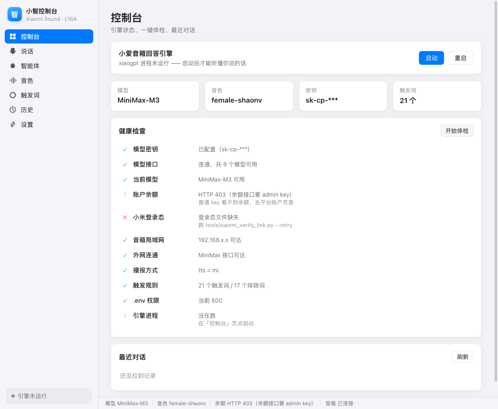

# 控制台（中控页）使用说明

打开控制台后的**第一页**就是中控页，所有关键状态和应急操作都在这一屏。



> 上图为脱敏后的真实界面截图。

---

## 一、页面结构

从上到下四块：

| # | 区块 | 内容 |
|---|---|---|
| 1 | **引擎卡** | xiaogpt 进程状态 + 「启动」/「重启」按钮 |
| 2 | **四张统计卡** | 当前模型、音色、密钥（掩码）、触发词数量 |
| 3 | **健康检查** | 一键体检，11 项检查 |
| 4 | **最近对话** | 音箱最近说过的对话记录 |

底部状态栏常驻显示：模型、音色、余额、音箱连接状态。
左下角**引擎状态胶囊**随时可点，点击即启动/停止引擎。

---

## 二、引擎卡

```
小爱音箱回答引擎
xiaogpt 进程未运行 —— 启动后才能听懂你说的话        [启动] [重启]
```

| 状态 | 含义 |
|---|---|
| **xiaogpt 进程运行中** | 引擎正常，音箱说的话能被接住 |
| **xiaogpt 进程未运行** | 引擎没起，音箱说的话不会转给智能体 |
| **pid xxxxx（不是这个窗口启动的）** | 引擎在别的进程里跑着（命令行 `./run.sh` 起的），控制台可以接管它 |

> **「启动」和「重启」的区别**：
「启动」在没跑的时候拉起来，在跑的时候就是停止；「重启」总是重起一遍。
改了 `config.yaml` 里的东西（比如音色、模型、人设）后要「重启」才生效 ——
因为配置是引擎启动时读的。

---

## 三、四张统计卡

一眼看清当前生效的配置：

| 卡 | 显示 | 改它去哪儿 |
|---|---|---|
| **模型** | 如 `MiniMax-M3` | 「智能体」页 |
| **音色** | 如 `female-shaonv` | 「音色」页 |
| **密钥** | 掩码（如 `sk-cp-***`） | 「智能体」页 |
| **触发词** | 数量（如 `21 个`） | 「触发词」页 |

卡片每 4 秒自动刷新一次，不用手动刷。

---

## 四、健康检查（一键体检）

点「开始体检」，跑一遍 11 项检查：

```
✓  模型密钥        已配置（sk-cp-***）
✓  模型接口        连通，共 9 个模型可用
✓  当前模型        MiniMax-M3 可用
!  账户余额        HTTP 403（余额接口要 admin key）
                   普通 key 看不到余额，去平台账户页查
✕  小米登录态      登录态文件缺失
                   跑 tools/xiaomi_verify_link.py --retry
✓  音箱局域网      192.168.x.x 可达
✓  外网连通        MiniMax 接口可达
✓  播报方式        tts = mi
✓  触发规则        21 个触发词 / 17 个排除词
✓  .env 权限       当前 600
!  引擎进程        没在跑
                   在「控制台」页点启动
```

### 三个符号

| 符号 | 含义 | 要不要管 |
|---|---|---|
| **✓** | 正常 | 不用管 |
| **!** | 有情况但不致命 | 看情况。比如「账户余额 403」只是普通 key 看不到余额，不影响使用 |
| **✕** | 坏了 | **必须处理**，后面那行灰字就是处理办法 |

### 各项的说明

| 检查项 | 查什么 | 失败怎么办 |
|---|---|---|
| 模型密钥 | `.env` 里有 key 没 | 跑 `tools/setup_wizard.py` |
| 模型接口 | MiniMax 接口通不通、能拿到几个模型 | 检查网络和 key 区域对不对 |
| 当前模型 | 配的模型在不在可用列表里 | 在「智能体」页换成列表里有的 |
| 账户余额 | 余额够不够 | 普通 key 看不到是正常的，去平台账户页查 |
| 小米登录态 | token 在不在、有没有过期 | `tools/xiaomi_verify_link.py --retry` |
| 音箱局域网 | 音箱 IP 能不能 ping 通 | 不影响云端链路；本机推音频会受影响 |
| 外网连通 | 能不能连上 MiniMax | 检查网络 |
| 播报方式 | 当前 `tts` 是 `mi` 还是 `minimax` | 正常 |
| 触发规则 | 有没有触发词 | 触发词为空会是 ✕ |
| .env 权限 | 是不是 600 | `chmod 600 .env` |
| 引擎进程 | 引擎在不在跑 | 在本页点「启动」 |

> **「音箱局域网」这一项默认会跳过。**
它需要一个音箱 IP —— 先查出来再设：
```bash
export SPEAKER_IP=<你的音箱局域网IP>
```

---

## 五、最近对话

拉取音箱最近的对话记录 —— 你说过什么、小爱答了什么。

点「刷新」重新拉。

> **这个功能依赖小米云登录态**。登录态过期时这一块会空着，
体检里的「小米登录态」会同时报 ✕。

---

## 六、常见问题

| 现象 | 原因 / 办法 |
|---|---|
| 音箱说话没反应 | 引擎没跑 —— 看第一张卡，点「启动」 |
| 改了设置没生效 | 配置是引擎启动时读的，点「重启」 |
| 体检说小米登录态坏了 | token 过期了，跑 `tools/xiaomi_verify_link.py --retry` |
| 体检说账户余额 403 | 正常，普通 key 查不到余额 |
| 音箱局域网这项没有 | 没设 `SPEAKER_IP`，默认跳过 |
| 想看引擎在干什么 | 「设置」页有实时日志 |
| 引擎显示「不是这个窗口启动的」 | 命令行 `./run.sh` 起的，控制台可以接管 |